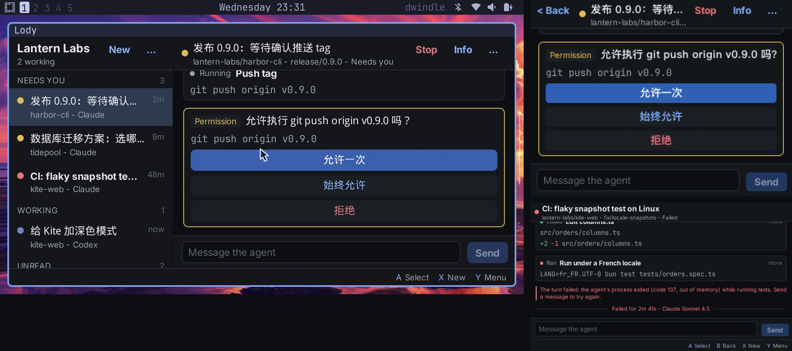
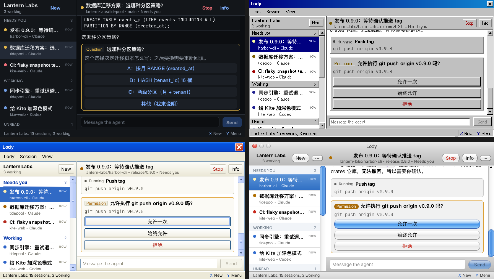
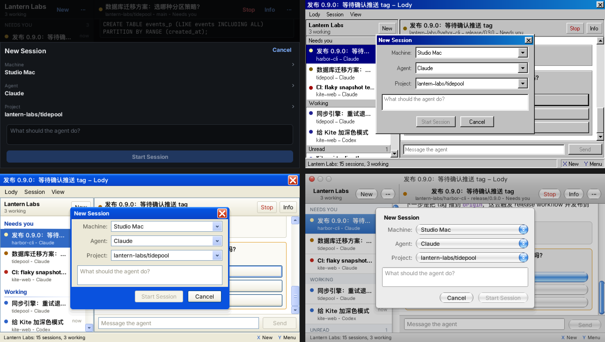

# Pocket Lody

[Lody](https://github.com/LodyAI/Lody) on a handheld: the sessions of a team's coding agents, their transcripts, and a composer, as a Pocket applet built on [PocketUI](https://github.com/pocket-nexus/pocketui). It runs in a window of Omarchy Pocket on an AYN Thor, and the same package source runs on a 320×240 touch surface and on a 480×272 screen with buttons and no touch.

<p align="center"></p>

The picture is the applet on its fixture data: an AYN Thor's upper display read back over adb, and PocketJS's simulator at 320×240 with touch and at 480×272 with buttons only.

**Status: 0.2.** On an AYN Thor, with nothing running on a computer: the driver set up on the device, a real sign-in confirmed by the account's owner, the workspace's sessions, a session's transcript, a message typed and sent from the device and its agent's answer read there, the session archived with the pad; and the four themes changed with the pad. **The data path is slow**: each step is a cold run of the `lody` CLI under proot, 12 to 40 s on the Thor ([Limits](#limits)). Starting a session from the Thor did not work on the account it was tried on: the driver there listed no agent for the owner's own computer.

## Themes

<p align="center"></p>

The application names no colour, border or font. It says what things are (a bar, a selected row, a card that waits for an answer, the default button, the field) and which commands exist and what menu each belongs to; PocketUI's active theme paints and arranges them ([PocketUI, Themes](https://github.com/pocket-nexus/pocketui#themes)). **Theme** in the commands (the View menu where there is a menu bar) lists Pocket, Classic 98, XP and Aqua, and the choice is kept. The change happens under whatever is going on: an open session stays open, a draft keeps its text and caret, the transcript its place.

| | Pocket | Classic 98 | XP | Aqua |
| --- | --- | --- | --- | --- |
| New, Stop, Info | controls in the pane's bar | bar buttons, and the Lody / Session / View menus | the same | toolbar capsules, the rest behind "more" |
| The title bar's close control | none | closes the open session; disabled when none is open | the same | the red light; the other two lights are drawn disabled |
| New Session | a sheet from the bottom edge: three rows that open lists, Cancel beside the heading, Start as a wide button | a window with a title bar: three combo boxes, Start and Cancel centred at the foot | the same, the buttons trailing | a window with a heading: three popups, Cancel then Start at the foot |
| Session Info, beside the transcript | a panel under the bars | a tool window with a close box | a blue-edged panel with a red close box | a grey panel with a red light |
| The pointer resting on a menu row | a tint | navy | blue | blue |

<p align="center"></p>

The manifest lists `pointer` among the applet's services: Omarchy Pocket's shell then tells the window where the stage pointer rests over it, and what is under it shows so (a menu's row, a toolbar control).

`app/create.tsx` is that form: three `Picker`s, a field, and `actions`. `app/semantic.test.ts` fails if a view names a colour, an edge, a radius or a theme.

The pictures are the simulator at 640×360 on the fixture data. Classic is set in the pixel face the package carries (`app/pak.json`, `app/themes.ts`).

## What it is made of

| Path | Contents |
| --- | --- |
| `app/` | The applet: `app.tsx` (the three panes and the commands), `sessions.tsx`, `session.tsx`, `items.tsx` (one transcript item as elements), `composer.tsx`, `info.tsx`, `create.tsx`, `link.tsx` (setting the device up and signing in: the page's QR code, the code, the countdown), `themes.ts`, `store.ts` (the workspace as the applet holds it), `net.ts` (the worker's transport, from pocket-nexus/applets) and `faces.ts` (the way from PocketUI's run-time faces to the companion's glyphs service, and the characters of what arrives asked for ahead) |
| `protocol.ts` | What the applet and the service say to each other |
| `service/` | The `lody` companion service: `service.ts` (routes, revisions, the held request), and three drivers behind one interface (`backend.ts`): `fixture.ts`, `cli.ts`, `remote.ts`. `serve.ts` runs it as an HTTP server; `provider.ts` is its form inside omarchy-pocketd or Pocket Hub |
| `tools/` | `sim.ts` (the applet in PocketJS's simulator on any surface, against the service in process; the runner is PocketUI's), `build.ts` (the package for a host contract), `thor.ts` (build, push, open, capture, provision and call the service on a device over adb), `paths.ts` (where the dependencies are, alone or vendored) |
| `vendor/` | `pocketui`, `pocketjs` and `applets`, as submodules |
| `test/app.test.ts` | The applet on three surfaces, driven by taps, drags, buttons and keys |

## How the data gets there

Lody has no HTTP API for sessions: a workspace is a set of Loro CRDT documents synced through Loro Streams, and Lody's own clients embed the CRDT runtime. An applet's realm is QuickJS with no network of its own, one request of at most **1020 bytes**, and responses that arrive whole. So a service sits between:

```
applet (QuickJS)  ──  its worker's http node  ──  https://companion.pocket/lody/…
                                                        │
                    omarchy-pocketd on the device, or Pocket Hub on a paired Mac
                                                        │
                                   service  ──  a driver
                                                             ├─ cli      the lody CLI, as a subprocess
                                                             ├─ remote   a serve.ts on another computer
                                                             └─ fixture  an invented workspace
```

- **A change reaches the applet by a held request.** `GET /sync?rev=<n>&session=<id>&srev=<m>&wait=20` is answered when the workspace is past `rev` or the open session past `srev`, or after `wait` seconds unchanged. One request is in flight at a time.
- **A transcript arrives as changes.** With `srev` the service sends the items that changed and the order of all it has given; the applet merges by id and keeps the objects of items that did not change, so their rows are not laid out again.
- **A message over one request's size goes up in parts** (`POST /draft?id=…&part=n`, 600 UTF-8 bytes each) that `/send` joins.
- **The service projects.** A row or an item arrives as the applet draws it (a state, a title, a one-line detail), because the applet's realm is the slow end.

`protocol.ts` is the whole contract.

### The drivers

| Driver | What it gives | Where it runs |
| --- | --- | --- |
| `cli` | Workspaces, sessions with live state (one long-lived `lody session observe --follow`), each turn's text, send, create, stop, archive, rename. **No tool calls, thoughts, plans or permission prompts: `lody session history` carries the last visible text of a turn only**, and the CLI has no command that answers a permission. A waiting session says to answer in Lody on a phone or a computer. | Any computer with the `lody` CLI signed in and a Node it runs on (24.22.1 or later), or the handheld itself: the service fetches both into its store and signs the device in as a machine of its own ([below](#the-driver-on-the-device-itself)) |
| `remote` | Whatever the far driver gives | A device whose daemon reaches a `serve.ts` on another computer |
| `fixture` | Every item kind on invented data, and a simulated agent that answers a message over seven seconds | Tests, screenshots, a first look |

Every CLI command starts cold, signs in and joins the workspace's documents before it answers. Measured on an M-series Mac against a workspace of 338 sessions: `session list` takes 5 to 8 s, `session history` 6 to 12 s, `session create` 23 s, `session chat` 21 s and `session archive` 13 s. The CLI has no mode that stays running for a client: its `observe --follow` reports a turn's state and never its text, and its MCP server speaks only to a Lody daemon's socket. So the `cli` driver hides what it can of that:

- it keeps what it read, re-reads a session when `observe` says it changed, and re-reads an open working session as soon as 1.5 s after the last read ended;
- a message is shown as sent the moment it is written, and marked failed if Lody refuses it;
- a session it started is listed and opens at once with its first message, before `session list` or `session history` know it;
- archiving, restoring and renaming move the row at once and are undone if Lody refuses;
- a turn that ended stays "working" until a history read after its end is held, so the answer and the end arrive together.

**Text in a working session is still 6 to 15 s behind**, and stays so until a driver reads the session's document itself.

The driver is chosen by `~/.local/share/omarchy-pocket/companion/services/lody/config.json` on the device:

```json
{ "driver": "remote", "url": "http://127.0.0.1:4317", "key": "…" }
{ "driver": "cli", "node": "/usr/bin/node", "cli": "/usr/lib/node_modules/lody/dist/index.js" }
{ "driver": "cli", "dataDir": "account", "machineName": "AYN Thor" }
{ "driver": "fixture" }
{ "driver": "fixture", "start": "setup" }
```

`dataDir` gives the bridge an account of its own (a relative path is inside the service's store), which `/signout` may end; without it the driver uses the computer's own `~/.lody` and refuses to sign that out. `machineName` is the name a sign-in made here registers the device under. A fixture with `"start": "setup"` or `"signed-out"` begins where a device without an account does, to show the way in on sample data.

With no file it is `cli` when a CLI and a Node are found, else `fixture`; on a Linux device the fixture then carries an offer to set the device up (`link.setup`). A driver that cannot start is not a crash: the applet's list pane says what is wrong, with the service's own sentence.

## On an AYN Thor

[Omarchy Pocket](https://github.com/pocket-nexus/omarchy-pocket) vendors this repository at `vendor/pocket-lody`: its app carries the applet (`bun tools/android.ts lody` there builds it for each handheld beside the others), and omarchy-pocketd carries the service (`daemon/companion.ts` imports `service/provider.ts`). In that checkout:

```sh
git submodule update --init vendor/pocket-lody
git -C vendor/pocket-lody submodule update --init vendor/pocketui vendor/applets   # PocketJS is the one beside it
bun tools/android.ts all                 # lib, proot, daemon, shell, applets, lody, apk, install
```

The device tools here (`tools/thor.ts`) build against that checkout: they find it two directories up, or at `OMARCHY_POCKET`.

Open **Lody** from the Apps list, or with `omarchy-shell pocket.window open lody` in the root. Without a config it shows the fixture.

### The driver on the device itself

Nothing runs on a computer: omarchy-pocketd runs the `lody` CLI in the device's Linux root, signed in as a machine named after the device.

1. **Setup.** `POST /setup` (what `link.setup` offers) downloads Node 24.22.3 for the device's architecture from nodejs.org, runs it only if its SHA-256 is the one pinned in `service/setup.ts`, installs `lody` 0.113.1 with that Node's npm, and writes `{"driver":"cli","dataDir":"account","machineName":…}`. About 90 MB comes down and 400 MB is written to `~/.local/share/omarchy-pocket/companion/services/lody/{node,lody-cli}`; on a Thor it took 40 s. The link says what it is doing (`"Downloading Node (12 of 30 MB)…"`) and, if it fails, why.
2. **Sign-in.** `POST /signin` runs `lody login --machine-name <name>`: Lody's device authorization. The link then carries the page (`https://lody.ai/device?user_code=…`), the code, the page as a QR code (`link.qr`), and when the code expires (ten minutes). The owner opens the page on a phone or a computer where they are signed in to Lody and confirms the code; the driver then loads the workspace. `/signout` calls a waiting sign-in off, or ends the device's account.

From a computer over adb, for development, the same in two commands and without the downloads on the device:

```sh
bun tools/thor.ts provision          # Node and the CLI for linux-arm64, pushed into the store
bun tools/thor.ts config device      # the config above, named after the device's model
```

and to drive and read the service on the device without the applet:

```sh
bun tools/thor.ts call GET '/sync?rev=-1'      # as the applet's worker asks: through omarchy-pocketd's bridge
bun tools/thor.ts call POST /signin '{}'
bun tools/thor.ts daemon             # this checkout's omarchy-pocketd into the root, restarted
bun tools/thor.ts log 40             # its last lines
```

Node gives each address of a host 250 ms to connect; on a handheld's Wi-Fi under proot a good connection can take longer, and commands ended in `fetch failed` within a second. The driver runs the CLI with `--network-family-autoselection-attempt-timeout=5000`.

### Through a bridge on a computer

**A real workspace through a bridge on this computer**, over USB (the CLI's sign-in is the computer's):

```sh
openssl rand -hex 16 > key
bun service/serve.ts --driver cli --key-file key        # needs the lody CLI signed in here
adb reverse tcp:4317 tcp:4317
bun tools/thor.ts config '{"driver":"remote","url":"http://127.0.0.1:4317","key":"<the key>"}'   # restarts omarchy-pocketd
```

`serve.ts` binds only a loopback address unless it has a key: anyone who reaches it reads the workspace and sends messages as its owner. On a network instead of USB, start it with `--host 0.0.0.0 --key-file key` and put the computer's address in the config.

### What the pad does

Omarchy Pocket gives an applet's window the stage pointer's contacts. **An applet that declares a presentation driven by buttons alone hears the pad's plain buttons too** (Omarchy Pocket's `shell/src/app.tsx` and `daemon/apps.ts`), which Pocket Lody does: the D-pad moves the focus to the nearest control in that direction, A selects, B goes back, X is the pane's main command (New, or Stop while an agent works), Y lists every command. The shoulders stay the window manager's. While the composer has the keyboard the deck shows its keys and the pad types them, as in any other field.

## Working on it

```sh
git submodule update --init vendor/pocketui vendor/pocketjs vendor/applets
(cd vendor/pocketjs && bun install)
```

```sh
bun tools/sim.ts --do "frames:100;tap:100,170;frames:60;shot:/tmp/a.png"   # 640x360, fixture data
bun tools/sim.ts --size 320x240 --do "…"      # a 3DS's lower screen
bun tools/sim.ts --psp --do "press:DOWN;press:CIRCLE;shot:/tmp/p.png"
bun tools/sim.ts --theme aqua --do "frames:60;theme:classic;cmd:session.new;shot:/tmp/t.png"   # a theme to start in, changed while it runs
bun tools/sim.ts --start signed-out --do "…"  # the way in: setup, sign-in, on the fixture
bun vendor/pocketui/tools/sim.ts --do "…"                # PocketUI's gallery
bun test ./test                                        # the applet on three surfaces, and in each theme
bun test ./app ./service                               # the store and the service
bun run typecheck
```

The simulator needs its wasm core once: `rustup target add wasm32-unknown-unknown` for the pinned toolchain, then `bun vendor/pocketjs/tools/wasm.ts`. Chinese draws in the simulator through Pocket Hub's glyphs service where there is a checkout of it beside this repository (Omarchy Pocket's `vendor/pocket-hub`, with `git -C vendor/pocket-hub submodule update --init vendor/pocketjs`) or at `POCKET_HUB_ROOT`; it uses CoreText on a Mac. `bun tools/sim.ts --fake-glyphs` and the tests use a stand-in instead (`tools/glyphs-fake.ts`: a box for each character, the same on every computer), and `bun tools/text-bench.ts` counts on it what a long Chinese transcript costs: requests, bytes, frames until the text is whole, layouts, and what scrolling back over it costs (nothing).

On a device running a build that `run-as` reaches (`bun tools/android.ts apk --debuggable`, which is the release build signed with the release key: it installs over a published release and keeps its Linux root):

```sh
bun tools/thor.ts build push open shot first      # .cache/shots/first-{up,low}.png
bun tools/thor.ts sh 'omarchy-shell pocket.input hold DOWN 3'
```

## Limits

- **Through the `cli` driver a transcript is text.** Tool calls, diffs, plans and permission prompts are drawn (the fixture has all of them, and `test/app.test.ts` and the pictures show them) and wait for a driver that reads the session's CRDT document. Lody's mobile clients do that through a JSON contract over an embedded runtime (`cloud-runtime` in LodyAI/lody-android); hosting that runtime in the bridge is the next driver.
- **One test session exists in the real workspace**, titled as a test and archived. It was created, answered and followed up through the service on a Mac. On the Thor, signed in as a machine of its own, it was restored, read, sent one message from the composer (the agent's answer arrived), and archived from the command menu. Stopping a turn and renaming ran only against the fixture and a fake CLI that prints the real one's shapes.
- **On the Thor every step waits for the CLI.** Measured there on a workspace of 150 listed sessions: the first list after choosing the workspace 75 s (later lists 13 s), a session's history 12 to 21 s, `session chat` 40 s (the message showed as delivered after 27 s and the answer after 45 s), archive 21 s, restore 20 s. One restore failed with the CLI's `Streams sync failed: network_error` and worked when asked again. A driver that keeps the workspace's documents open, instead of starting the CLI for each step, is what would change this.
- **A message just sent can show twice for some seconds** through the `cli` driver, until the history read that carries it replaces the one shown at once.
- **Starting a session needs an agent the driver can name for the chosen machine.** `lody machine list --include-agents`, run as the Thor, gave agents for other people's machines and none for the owner's computer, so New Session had no agent to offer there.
- **Run-time glyphs hold about 480 characters a face at density 3.** One atlas has to fit a response; a transcript with more distinct Chinese characters on screen than that makes the atlas start over, and text shows dots until its glyphs return.
- **A surface that must draw its own keyboard gets no keyboard yet** (PocketUI's `dock` idiom). Reading, the commands and the menus work on a PSP-shaped surface; composing does not.
- **Attachments, images, the file browser, diffs beside the transcript, the terminal, schedules and settings are not here.**

## License

The applet imports pocket-nexus/applets' `lib/net.ts`, `lib/net-worker.ts` and `ui/glyphs.ts`, which are GPL-3.0-or-later, so the applet's package is distributed under those terms. So this repository is GPL-3.0-or-later ([LICENSE](LICENSE)). PocketUI (`vendor/pocketui`, MIT) imports nothing from there, and `service/` imports neither; `service/qr.ts` is PocketJS's encoder (MIT), copied with its notice. Lody is LodyAI's; this is an independent client that talks to it through its published command-line tool.
